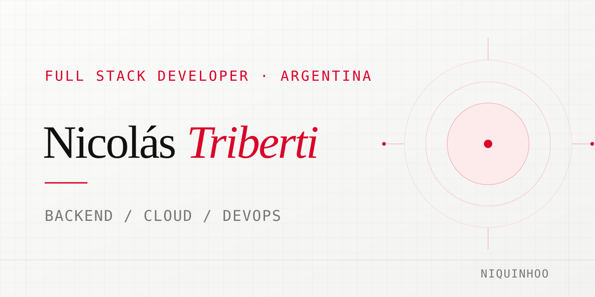
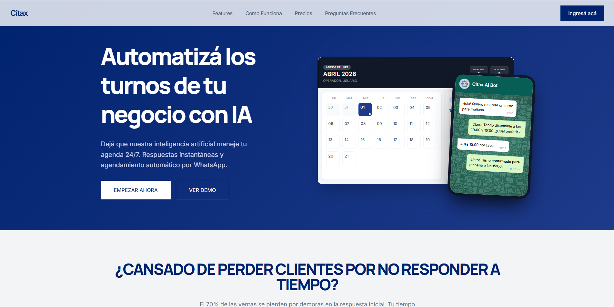
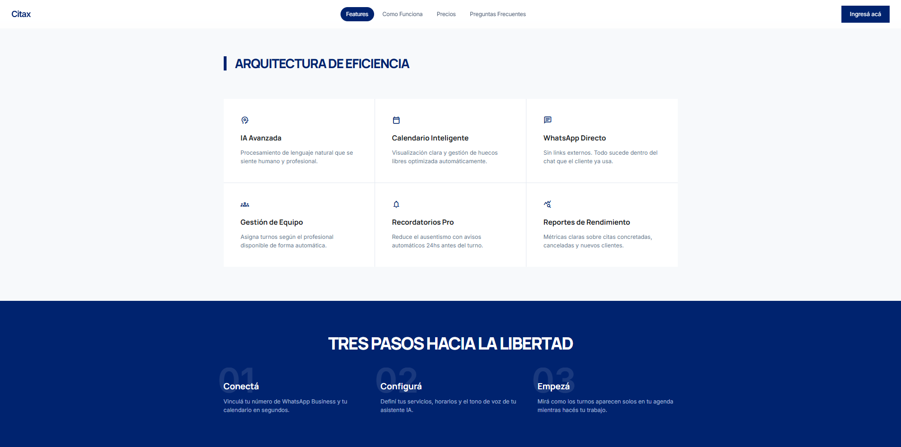

  

<h1 align="center">Hola, soy Nicolás Triberti </h1>

  Desarrollador Full Stack de Argentina, estudiante avanzado de Programación Universitaria de Sistemas, con 2+ años de experiencia y foco en backend, infraestructura cloud y automatización.

  <a href="https://niquinhoo.github.io/FNT-PortFolio/">Portfolio</a> ·
  <a href="mailto:nicotrib699@gmail.com">Email</a> ·
  <a href="https://www.linkedin.com/in/nicolas-triberti-224651247/">linkedin.com/in/nicolastriberti</a>

  

  

## Sobre mí

Construyo soluciones completas para entornos reales: diseño APIs, integro servicios, modelo datos y preparo despliegues confiables. También desarrollo flujos agénticos para automatizar tareas de negocio.

## Proyecto destacado

### [Citax](https://www.citax.com.ar/)

SaaS de gestión de turnos por WhatsApp. Desarrollé e integré su API, procesos automatizados y servicios de IA, con despliegues en Docker. Sus agentes han procesado **más de 1.000 turnos de manera agéntica**.

Node.js · Express · MySQL / TiDB · WhatsApp Business API · LangGraph · LangChain · React · Docker

<table>
  <tr>
    <td width="50%"></td>
    <td width="50%"></td>
  </tr>
</table>

## Tecnologías

**Backend y datos**  
Node.js · TypeScript · JavaScript · Express · APIs REST · Prisma · PostgreSQL · MySQL · TiDB · Cloudflare D1

**Cloud e infraestructura**  
Cloudflare Workers · Cloudflare R2 · Docker · Linux · AWS EC2 / S3 · VULTR Cloud Compute · Oracle OCI

**DevOps y calidad**  
Git · GitHub Actions · CI/CD · Testing · Linting · Observabilidad

**Automatización e IA**  
Webhooks · WhatsApp APIs · Modelos de IA · Automatizaciones

**Frontend**  
React · React Native · Vite · Tailwind CSS · GSAP

**Integraciones y visualización**  
Mercado Pago · Google Earth

---

<i>Desarrollando soluciones completas para entornos reales.</i>

